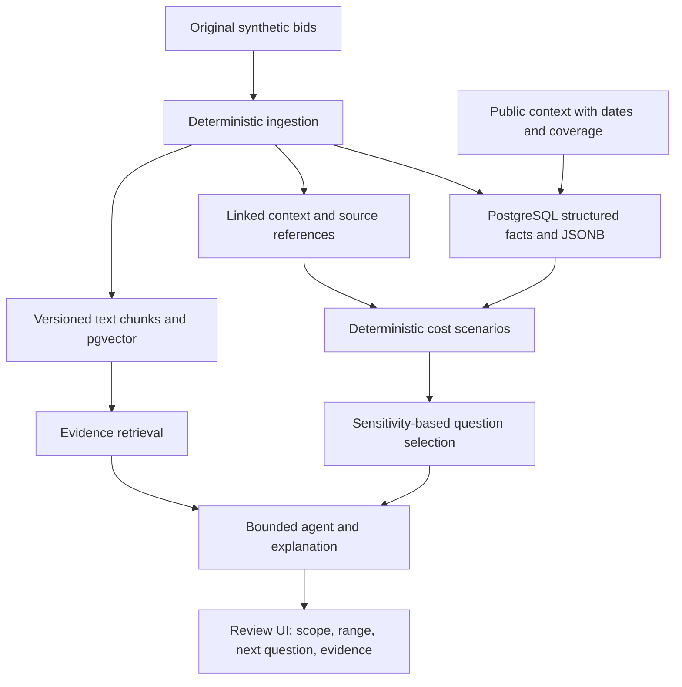

# Architecture

## Data, retrieval and graph

PostgreSQL is the deployment datastore. Structured tables hold money, quantities, dates, supplier and project relationships. JSONB retains complete source records. `context_edges` stores explicit relationships; this is a small context graph within PostgreSQL, not a claim about a particular graph technology.

`HAS_QUOTE`, `SUBMITTED_BY`, `HAS_LINE`, `PRICES_SCOPE`, and `SUPPORTED_BY` edges preserve document/path/line evidence. This prototype has revision-1 quotes; a future version must append revision events and explicit supersession edges rather than overwriting evidence.

The local fallback is SQLite. Both implement the same store interface. The checked-in embeddings are a free, deterministic, signed lexical-hashing baseline. Similarity scores are retrieval scores, not confidence probabilities or proof of scope equivalence.

Date and project restrictions are applied before vector ranking. PostgreSQL uses an exact search over eligible rows; it avoids silently losing relevant filtered candidates through an approximate-index query. A true semantic encoder can replace hashing through an index-version migration and complete reindex. Embeddings and financial calculations remain separate.

## The novel experimental capability

The user starts with an incomplete pre-tender scope. The question planner enumerates two explicit answers for each of three unknowns: depth, rock fraction and spoil haul distance. The cost engine evaluates each combination against earlier synthetic quotes.

For a candidate question, the planner compares the initial range width with the mean conditional width after its two answers. It ranks by potential tightening under an explicitly equal-weighted demonstration assumption. It does **not** claim a learned probability distribution, causal identification or global optimality.

This isolates a useful product hypothesis: does sensitivity-aware clarification help a user reach a useful estimate with fewer questions than a fixed sequence? Real data, customer validation and realistic priors would be needed to establish that value.

## Agent boundary

Scripted mode remains operational without a model. Optional GPT-6 Luna can answer directly or choose general arithmetic, component pricing, bid search, cached public context, generic dataset discovery/search or a live public web lookup. The agent chooses formulas and provisional rate/quantity bounds; deterministic tools evaluate the arithmetic. Source-referenced quote rates are resolved from the original record, so a conflicting proposed rate cannot replace them. Unreferenced rates are explicitly labelled model allowances. An unknown survey quantity can support a provisional scenario without being represented as measured fact.

The structured brief retains flexible user/source/calculated/assumed facts, the last working estimate survives conceptual replies, and the UI shows an updating range with qualitative input confidence. Each answer has a short collapsed provenance explanation. Confidence is not a calibrated probability. Stand-alone levelling is never automatically priced as the full multi-zone package.

Calculation and Context are projections of the active conversation rather than seeded dashboards. The API returns every successful tool step, its arguments, bounded evidence and original source references. Context accumulates the current brief's facts and consulted evidence; Calculation displays actual calculated quantities and the latest component/package range. They do not load preset locations, thresholds, dates or unrelated datasets on opening. State is saved as one simulation in the browser session. Refresh starts with empty panels and offers an explicit Resume previous simulation; New project clears all three panels and invalidates in-flight bid loads. Bids resolves actual retrieved quote IDs, with a separate explicit reference-job selector and no automatic first-job choice. Source quotation data remains synthetic.

Agent instructions require proactive investigation of constraints pertinent to the supplied location and work, discovering the responsible local, regional and national sources rather than waiting for the user to name a hazard. The same generic lookup handles this research; there is no hardcoded city-to-hazard mapping. Results must distinguish regional screening from a verified property/activity assessment. An unavailable address does not block indicative pricing; unresolved applicability remains explicit. An inaccessible interactive map or absent search result cannot become a claim of no restrictions. The agent assumes a non-specialist audience, uses working scenarios for missing technical details and normally asks one answerable, material question. Chat is text-only, so it must not request photos or file attachments. These are prompted behaviours, not a completed GIS/property-report integration or exhaustive regulatory clearance system.

Each turn allows three tool rounds, two calls per round and four local calls total. A single optional hosted public lookup adds one helper request. A received malformed/incomplete answer permits one explanation-only repair, for at most six model requests including search and repair. Tool fees, search-content tokens and model tokens share the persistent spend caps. Uncertain HTTP failures are not automatically retried and models are never upgraded. A failed repair preserves validated evidence/calculations, explicitly marking an older range as not updated. Bid and dataset source identities survive subsequent turns and are reconstituted from storage. Narrative fact changes after pricing are allowed; actual calculator inputs must reconcile. Logs record a non-content reason category. The agent cannot run arbitrary SQL, import/edit evidence, send messages or execute Python. The arithmetic evaluator accepts a small numeric AST, never general code. No calendar-specific response logic or holiday dates are hardcoded.

Original evidence and deterministic arithmetic are authoritative for the values they supply. The model's choice of geometry, relevance, allowances and confidence remains an explicit judgement. No model is fine-tuned on fictional bids.

## External context

The public release bundles an attributed ERA5 weather snapshot with 300 project-to-weather links. Fuel and soil adapters and typed tables remain, but their extracts are not bundled. Optional sources are installed only through an operator action after reuse terms are checked. The live conversational tool can separately look up a relevant public fact, returning source URLs and retrieval time. Wet-weather scenarios union rain and assumed recovery days; fuel and standby costs require explicit user allowances and are not added to the rate-based estimate. See PUBLIC_CONTEXT.md.

Additional datasets use a shared manifest and evidence envelope with arbitrary JSON facts, entity IDs, availability/effective dates and source references. New versions append; conflicting replacement of an existing version is rejected. The human-operated Data tab previews and imports CSV/JSON/JSONL, retains the original file and builds graph/index projections atomically. Its declared dictionary supplies purpose, units and codes through a separate generic inspection tool; missing semantics are not inferred from JSON shape. The agent has read-only catalogue/search/definition tools. The demonstration importer is synchronous and its filtered vector search is exact; see [the scale boundary](EVIDENCE_PLATFORM.md).

Store numeric weather/fuel/index series as date-effective records, geometry as spatial data and source descriptions as searchable documents. Capture publication time as well as effective time. Quote-time reconstruction must not include future actual weather or later rate revisions. Context is first useful for questions and matching; a price adjustment requires an explicit justified transformation.

## Scale path

The prototype is intentionally single portfolio. Before real multitenancy, tenant identity and access rules must become mandatory on every record, tool, index query and evidence fetch. At much greater volume, partition operational data, store original documents in object storage, maintain asynchronous ingestion/indexing and use a separate analytical engine for large cohort distributions. Keep bounded agent tools and evidence contracts stable while changing storage.

A billion quotes would imply many billions of line items and chunks. A single unfiltered vector index is not the architecture. Retrieval first narrows by permissions, time, trade, location, scope and units, while analytical queries use properly defined cohorts rather than treating every line as independent evidence.

## Public release controls

Public mode removes the visitor token gate, enforces a dedicated persistent US$3 shared model ledger and allows concurrent model turns against the same atomic spend cap. Stored datasets are read-only; preview is allowed, commit is rejected. Private-kind datasets are filtered from catalogue, search, definitions, records, originals and graph paths. The intro frames the general construction-agent concept; earthworks is the initial synthetic example.
