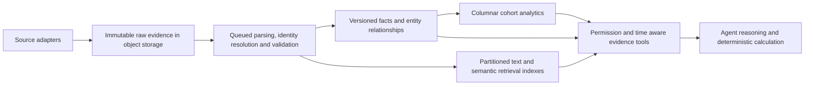

# Extensible evidence and the scale boundary

The implemented proof is small: import a previously unknown dataset and let the same agent discover, retrieve and cite its original facts, without adding a table, enumerating its fields in the prompt, or writing a new question handler. This addresses source extensibility. It does not establish production throughput.

## Data workbench

The fifth **Data** tab shows actual database counts and inspected SQL field types, plus registered evidence datasets and their objectives. Its human-operated importer accepts UTF-8 CSV, JSON arrays (or an object containing `records`) and JSONL/NDJSON, up to 2 MB / 1,000 records / 80 fields per batch. This upload is separate from text-only chat.

The operator declares record type, purpose, evidence kind and availability, maps identity/description/date/source/entity fields, and can provide each field's meaning, unit and value codes. JSON shape does not infer these meanings. The unchanged `inspect_dataset_definition` agent tool reads this dictionary; undefined units/codes remain unknown. Definitions are uploader assertions, not executable instructions or proof that a rule applies to a site.

Preview validates every record and shows representative facts and graph links without writing. Editing the file, metadata or mappings invalidates the preview. Commit revalidates its digest, then atomically stores the original file/hash, versioned records, retrieval vectors and entity references using a separate write connection. CSV values retain their original text, including leading zeros; JSON native types remain intact. Existing P/V/Q identifiers must exist. New namespaced external identities are literal references, not inferred matches to real entities.

Graph exploration follows dataset → record → linked entity/source, while the generic search tool finds newly committed evidence. Source-record and original-file inspection remain available after reload. No import automatically alters quote tables, pricing calculations or regulatory decisions. The bounded synchronous importer and shared demo token demonstrate the workflow; production ingestion still needs governed adapters, access controls, queues and scale testing.

## Common ingestion contract

Each source folder contains `manifest.json` and a JSONL file. The manifest declares `id`, `version`, `name`, `description`, `data_kind` (`synthetic`, `public` or `private`), `available_date` and `records_file`. Each record contains:

```json
{
  "id": "R1",
  "text": "A description to retrieve",
  "facts": {"any_new_field": {"value": 12, "unit": "m"}},
  "entities": ["P001"],
  "available_date": "2025-01-01",
  "effective_date": "2025-01-01",
  "source": {"uri": "synthetic:example/R1", "locator": "Original record R1"}
}
```

Run `python3 -m earthworks.datasets SOURCE_FOLDER`. Startup also discovers source folders in `data/datasets/`. A new raw format still needs an adapter into this contract; arbitrary PDFs are not automatically understood. Records are limited to 6,000 bytes in this prototype and should carry useful evidence units.

The importer retains original fact values and source references, adds the source-file SHA-256 and line number, and builds a separate retrieval projection. Immutable dataset versions allow corrections to append without erasing earlier evidence. Reimporting the same bytes is idempotent; changing an existing version is rejected. Bundled originals are retained in the repository and browser-uploaded originals in `dataset_uploads`; an object store and immutable raw snapshots would be needed for a production ingestion service.

The shared catalogue exposes newly encountered fact fields. `search_datasets` lists or searches any registered source. Searches apply availability, effective-date and optional entity restrictions before ranking, select the latest eligible dataset version, and return the exact original facts with a stable citation. The UI can open the source record. Similarity does not establish that the evidence applies to the user's job. For example, the fictional P001 access note is not a measurement of any real Brisbane site.

Tests introduce an unrelated source with previously unknown nested fields, retrieve and cite it through the unchanged agent tool, reject a destructive version overwrite, reconstruct earlier evidence by date, and preserve it through a quote-corpus rebuild. CI also exercises the same contract on PostgreSQL/pgvector.

## Why the datastore is hybrid

The source of truth is evidence plus exact facts and relationships. Flexible JSONB avoids a bespoke table for every new source. Typed tables remain useful for repeated commercial calculations. Vector indexes support discovery; they do not preserve every numeric constraint, identify duplicate jobs, enforce access rules or calculate reliable totals by themselves. PostgreSQL supports [indexed JSONB](https://www.postgresql.org/docs/current/datatype-json.html) and [pgvector alongside ordinary data](https://github.com/pgvector/pgvector), so these capabilities can coexist in the current small deployment.

Both current vector paths use versioned lexical hashing, not learned semantic embeddings. A semantic encoder is a replaceable retrieval projection requiring a new version, reindex and retrieval-quality evaluation. It is not yet installed. Core bid retrieval and the three cached public series still use their original paths; this change establishes the general additional-source path rather than claiming a completed platform migration.

## Proposed deployment at much greater scale



Tenant/access controls must be mandatory before real customer data. Identity resolution must distinguish revised quotes, projects, suppliers and duplicated evidence; otherwise a large corpus creates false statistical support. Publication/availability time and effective time remain separate. Source corrections require explicit downstream invalidation and reindexing.

At tens of millions or billions of records, replace the synchronous importer and in-memory/exact-scan paths with partitioned, incremental pipelines, filtered approximate retrieval with measured recall, and analytical queries over defined cohorts. Keep tool contracts stable while moving storage and indexes. Model context contains bounded evidence, never the full corpus. Benchmark ingestion, filtered-query latency, recall, revision handling and cost against representative workloads before claiming scalability. None of those production-scale benchmarks have been run by this demo.
